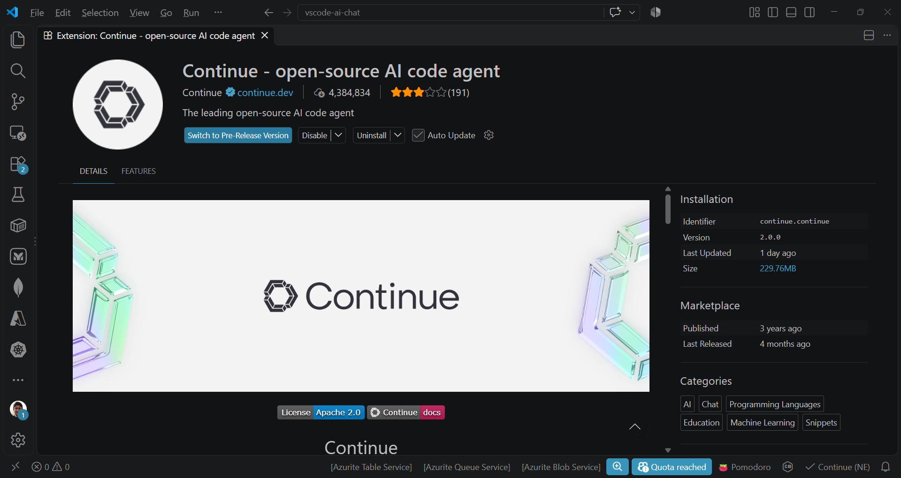
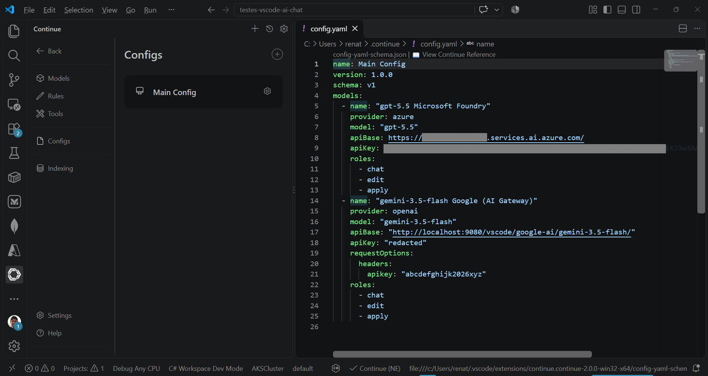
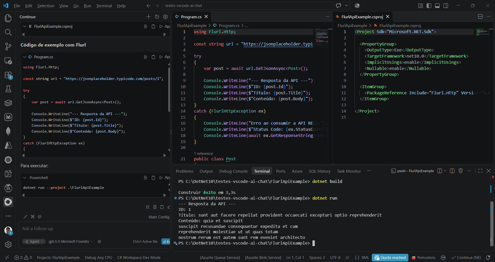
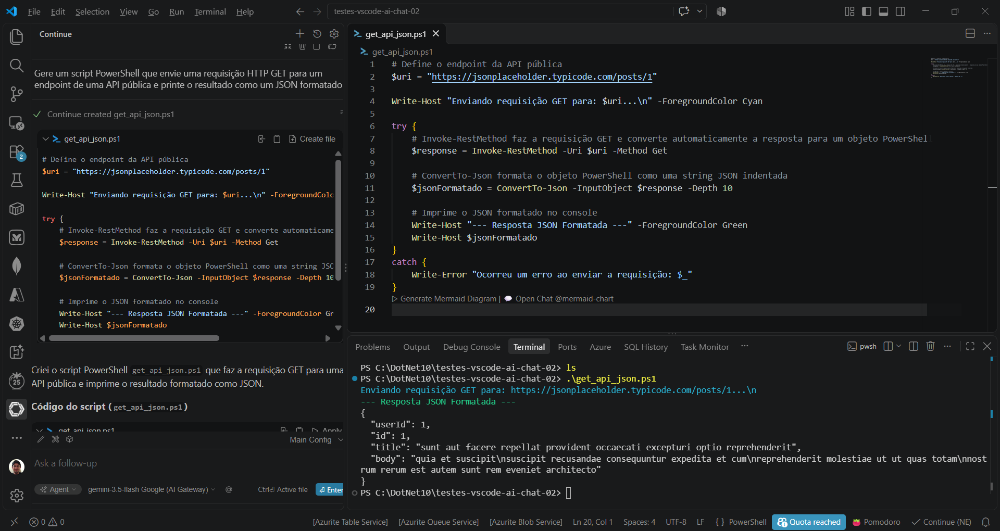
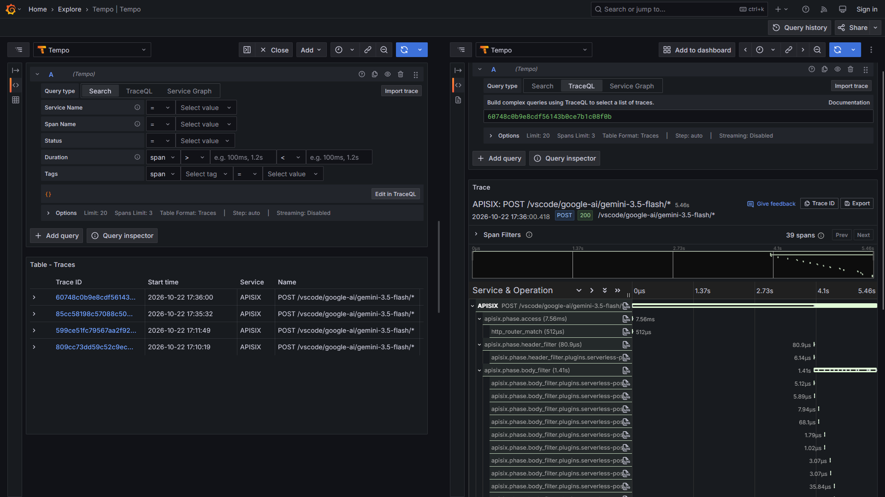

  # vscode-continue-aichat-foundry-google-apisix-aigateway
Configurações para uso no Visual Studio Code de modelos hospedados no Microsoft Foundry e Google Agent Platform/Vertex (através do uso do APISIX como AI Gateway) a partir da utilização da extensão Continue. Inclui monitoramento via stack Grafana e script do Docker Compose para a criação do ambiente de testes.

Saiba mais sobre a extensão **Continue** em: https://marketplace.visualstudio.com/items?itemName=Continue.continue



Configurando a extensão **Continue** para uso do AI Gateway:



YAML com as configurações:

```yaml
name: Main Config
version: 1.0.0
schema: v1
models:
  - name: "gpt-5.5 Microsoft Foundry"
    provider: azure
    model: "gpt-5.5"
    apiBase: "https://FOUNDRY_RESOURCE_NAME.services.ai.azure.com/"
    apiKey: "FOUNDRY_KEY"
    roles:
      - chat
      - edit
      - apply
  - name: "gemini-3.5-flash Google (AI Gateway)"
    provider: openai
    model: "gemini-3.5-flash"
    apiBase: "http://localhost:9080/vscode/google-ai/gemini-3.5-flash/"
    apiKey: "redacted"
    requestOptions:
      headers:
        apikey: "abcdefghijk2026xyz"
    roles:
      - chat
      - edit
      - apply
```

Um teste com um modelo do Microsoft Foundry:



Um teste com um modelo da Google acessado via APISIX (AI Gateway):



Trace gerado no Grafana Tempo:


